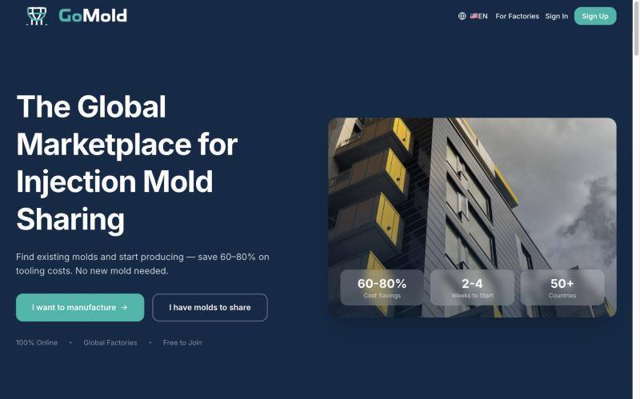
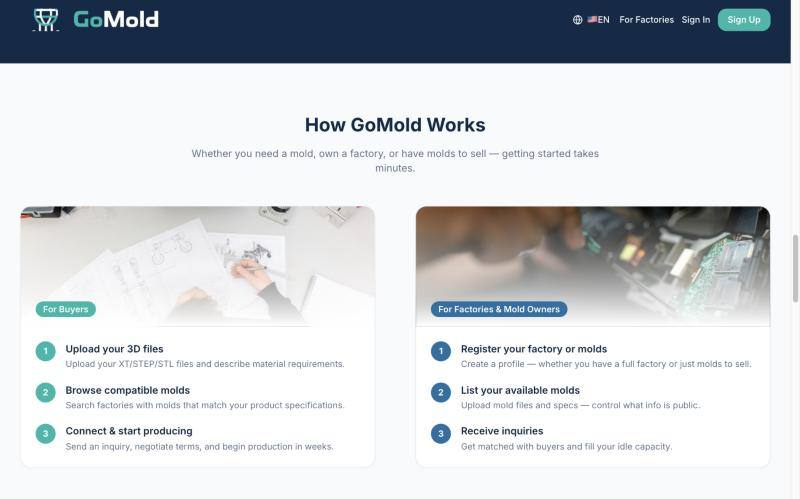
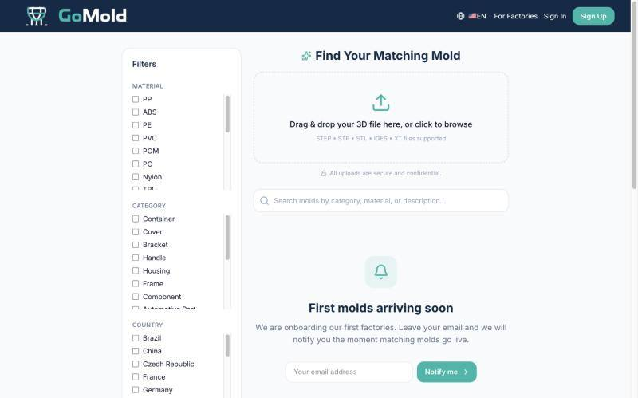

# GoMold: Global Marketplace for Injection Mold Sharing

**Live:** [gomold.co](https://gomold.co)

A two-sided B2B marketplace I designed, built and launched independently, connecting manufacturers who need production with factories and mold owners who hold idle molds.

## The problem
New injection molds are expensive and take weeks to months to fabricate, while many existing molds sit unused in factory warehouses. There was no dedicated platform for finding and reusing an existing compatible mold.

## The solution
- **Buyers** upload a 3D file (STEP/STL/XT/IGES), browse compatible molds and factories, and send inquiries directly
- **Factories & mold owners** list their molds, control which details are public, and receive inquiries to fill idle capacity
- **GoMold Complete**: an optional end-to-end path for users who only have an idea

## My role
End-to-end: market research, competitive analysis (Jiga, Xometry, Protolabs), product design, database design, development, launch, and international business development with manufacturers in Turkey and Germany.

## Tech stack
Next.js · Supabase (PostgreSQL) · Vercel · Resend

## What I learned
- Designing a relational data model for a two-sided marketplace (users, factories, molds, inquiries)
- Translating a market gap into a product and testing it with real industry players

## Status
Live and in early stage: currently onboarding the first factories and mold owners.

## Screenshots

